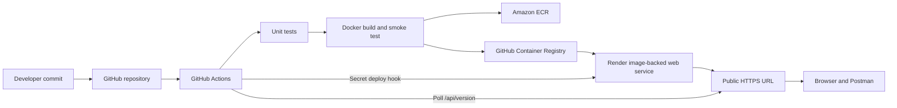

# Deployment architecture

## Trust boundaries

- GitHub Actions receives short-lived AWS credentials through OpenID Connect; no long-lived AWS access key is stored in GitHub.
- The Render deploy-hook URL is held as a GitHub Actions secret.
- The public application stores no submitted logs and makes no outbound enrichment requests.
- The image is tagged with the Git commit SHA and `latest`. `/api/version` proves which commit is live.

## Deployment sequence

1. A push to `main` starts GitHub Actions.
2. Python unit/API tests must pass.
3. Actions builds the Docker image and smoke-tests `/health` and `/api/version`.
4. The same image is tagged and published to Amazon ECR and GHCR.
5. GitHub Actions calls Render's secret deploy hook.
6. Render pulls the updated public GHCR image.
7. Actions polls the live `/api/version` endpoint until it returns the pushed commit SHA.

Amazon ECR provides AWS registry evidence. Render uses the public GHCR copy because the assessment account's AWS Free plan previously denied App Runner through a service-control policy.
